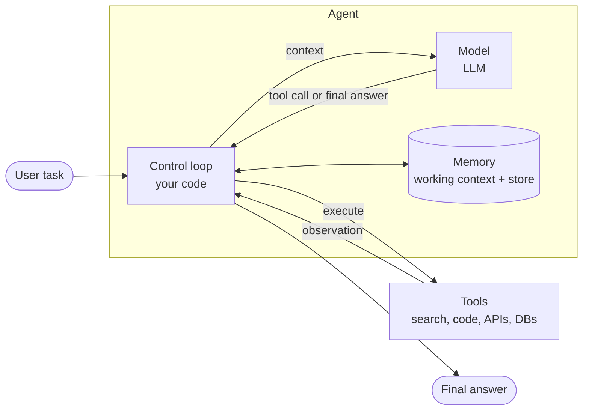

# Building Agentic AI Systems: A Practical Guide to Architectures, Design Patterns, and Implementation

**Sunil Javadi** · Independent Researcher · November 2026

## Abstract

Large language models (LLMs) are moving from answering single prompts to working as agents. An agent is a system that plans, calls external tools, observes the results and repeats until it finishes a task. This tutorial is a practical guide to building such systems. It separates fixed *workflows* from open-ended *agents*. It then breaks an agent into four parts: the model, the tools, memory and the control loop. Four common design patterns are covered: ReAct, plan-and-execute, reflection and orchestrator-workers. A minimal Python implementation of a tool-using agent loop shows how they work in practice. The guide also covers context engineering, the Model Context Protocol (MCP), evaluation with benchmarks such as SWE-bench, and defences against indirect prompt injection. It closes with open problems in reliability, cost and safety. The goal is to give practitioners a short, well-referenced route from first prototype to a production-ready agentic system.

**Keywords:** agentic AI, large language models, LLM agents, tool use, ReAct, multi-agent systems, Model Context Protocol, prompt injection, AI engineering

## 1. Introduction

A chatbot answers a single prompt. An agent works toward a goal over many steps. It decides which actions to take, uses tools such as search, code execution or APIs, and adapts to what it observes. Research on LLM-based autonomous agents has grown rapidly since 2023. Wang et al. survey this work and propose a unified framework built from profiling, memory, planning and action modules [1].

For practitioners, the hard part is engineering more than capability. Anthropic's guidance draws a line between two kinds of agentic system [2]. *Workflows* orchestrate LLM calls through predefined code paths. *Agents* let the model direct its own process and tool use. That guidance also advises starting with the simplest design and adding autonomy only when the task needs it.

This tutorial makes four contributions:

1. A reference architecture that splits an agent into model, tools, memory and control loop (Section 3).
2. A catalogue of design patterns, with guidance on when to use each (Section 4).
3. A minimal, runnable implementation of a tool-using agent loop (Section 5).
4. Practical guidance on context management, evaluation and security (Sections 6 and 7).

## 2. Background

Today's agents build on four lines of research.

| Line of work | Key idea | Representative paper |
| --- | --- | --- |
| Step-by-step reasoning | Prompting a model to write out intermediate reasoning steps improves multi-step problem solving | Chain-of-thought, Wei et al. [3] |
| Interleaved reasoning and acting | The model alternates thoughts, actions and observations, so its reasoning rests on real tool outputs | ReAct, Yao et al. [4] |
| Learned tool use | A model learns, self-supervised, which APIs to call, when to call them and with what arguments | Toolformer, Schick et al. [5] |
| Self-reflection | The agent writes verbal feedback on its failures into episodic memory and improves on later attempts without any weight updates | Reflexion, Shinn et al. [6] |
| Explicit planning | The model first drafts a plan, then carries out its steps | Plan-and-Solve, Wang et al. [7] |

ReAct showed that grounding reasoning in tool outputs, such as Wikipedia API lookups, reduces hallucination compared with chain-of-thought alone [4]. Reflexion showed that verbal self-feedback can match or beat strong baselines on coding, reasoning and decision-making tasks [6]. Both ideas are the main building blocks of the patterns in Section 4.

## 3. Core Architecture of an Agent

Every agent, however complex, has four parts: a model that reasons, tools that act, memory that persists, and a control loop that ties them together. Figure 1 shows how they connect. The model never touches the outside world itself. It proposes a tool call, the control loop (your code) runs it, and the result returns to the model as an observation.



*Figure 1. Reference architecture of a tool-using LLM agent.*

| Component | Role | Design decisions |
| --- | --- | --- |
| Model | Reads the context and decides the next action or the final answer | Model size vs. latency and cost; system prompt; temperature |
| Tools | Act on the world: search, code execution, databases, business APIs | Granularity, clear names and descriptions, input schemas, read-only vs. write access |
| Memory | Holds the working context and stores longer-term knowledge | What stays in context, what goes to a store, when to summarise |
| Control loop | Runs the reason, act, observe cycle and enforces limits | Stop conditions, step and cost budgets, error handling, human approval |

This split matches the profile, memory, planning and action modules in Wang et al.'s unified framework [1]. It also matches the "augmented LLM" building block in Anthropic's guidance [2].

## 4. Design Patterns

No single pattern is best. Choose the least autonomous one that solves the task, because each step up in autonomy adds latency, cost and new ways to fail [2].

| Pattern | How it works | Use when | Main risk |
| --- | --- | --- | --- |
| Prompt chaining (workflow) | A fixed sequence of LLM calls, each fed the previous call's output | The steps are known in advance | Rigid; cannot recover from unexpected input |
| ReAct loop (agent) | Thought, then action, then observation, repeated until done [4] | The path depends on what tools return | Loops, drift, rising token cost |
| Plan-and-execute | Draft a full plan first, then run and revise its steps [7] | Long tasks with a clear structure | The plan goes stale as facts change |
| Reflection / evaluator-optimizer | One pass generates; a critic (the same or another model) gives feedback; repeat [6] | A clear quality signal exists (tests, rubric) | A weak critic reinforces mistakes |
| Orchestrator-workers (multi-agent) | A lead LLM splits the task at run time, hands subtasks to workers, then combines their results [2] | Subtasks cannot be known in advance, e.g. multi-file code changes | Coordination overhead; errors compound |

**Rule of thumb.** Start with a single augmented LLM, meaning one model with retrieval and tools [2]. Move to a workflow if the steps are predictable. Move to an agent loop only when the model must choose its own path. Add multiple agents only when subtasks can run in parallel or need separate contexts.

## 5. Implementation Walkthrough

An agent loop fits in about 60 lines of Python. The example below uses the Anthropic Python SDK's tool-use interface. It gives the model two tools, then loops until the model stops asking for them or a step limit is hit. The same structure carries over to any provider whose API supports function calling. The full script is in [`agent.py`](agent.py).

```python
import json
import anthropic

client = anthropic.Anthropic()          # reads ANTHROPIC_API_KEY
MODEL = "claude-sonnet-5-5"

# 1. Tools: a name, a description the model reads, and a JSON Schema for inputs
TOOLS = [
    {
        "name": "get_weather",
        "description": "Get the current temperature in Celsius for a city.",
        "input_schema": {
            "type": "object",
            "properties": {"city": {"type": "string", "description": "City name"}},
            "required": ["city"],
        },
    },
    {
        "name": "calculator",
        "description": "Evaluate an arithmetic expression such as '3 * (4 + 5)'.",
        "input_schema": {
            "type": "object",
            "properties": {"expression": {"type": "string"}},
            "required": ["expression"],
        },
    },
]

# 2. Tool execution: plain code, run by YOUR program, never by the model
def run_tool(name: str, args: dict) -> str:
    if name == "get_weather":
        demo_data = {"Hyderabad": 31, "London": 9}   # stub: replace with a real API
        return json.dumps({"city": args["city"], "temp_c": demo_data.get(args["city"], 20)})
    if name == "calculator":
        expr = args["expression"]
        if not set(expr) <= set("0123456789+-*/(). "):
            return "error: unsupported characters"
        return str(eval(expr, {"__builtins__": {}}))   # demo only; use a real parser in production
    return f"error: unknown tool {name}"

# 3. The control loop
def run_agent(task: str, max_steps: int = 10) -> str:
    messages = [{"role": "user", "content": task}]
    for _ in range(max_steps):
        response = client.messages.create(
            model=MODEL,
            max_tokens=1024,
            system="You are a careful assistant. Use tools when they help.",
            tools=TOOLS,
            messages=messages,
        )
        messages.append({"role": "assistant", "content": response.content})

        if response.stop_reason != "tool_use":          # model is done
            return "".join(b.text for b in response.content if b.type == "text")

        results = []
        for block in response.content:
            if block.type == "tool_use":
                output = run_tool(block.name, block.input)
                results.append({"type": "tool_result",
                                "tool_use_id": block.id,
                                "content": output})
        messages.append({"role": "user", "content": results})
    return "Stopped: step limit reached."

print(run_agent("How much warmer is Hyderabad than London right now, in Fahrenheit?"))
```

Four details matter in production:

- **The step limit** (`max_steps`) is the simplest guard against runaway loops and runaway cost. Add a token or dollar budget as well.
- **Tool descriptions are prompts.** The model chooses tools only from their names, descriptions and schemas, so write them as carefully as a system prompt. Anthropic reports spending more time tuning tools than prompts when building its SWE-bench agent [2].
- **Errors go back as observations.** Return `error: ...` strings instead of raising exceptions. The model can then retry or change approach, which is the ReAct loop at work.
- **Your code executes the tools, not the model.** Every side effect passes through `run_tool`. That function is where permission checks, logging and human approval belong.

## 6. Context Engineering and Memory

An agent's context window is a scarce resource, and a larger window alone does not solve the problem. Liu et al. found that LLMs use information best when it sits at the start or end of the context. Accuracy drops sharply when the key facts sit in the middle, even for models built for long contexts [8]. Every tool result appended to `messages` in Section 5 therefore uses up attention as well as tokens.

Four techniques help:

- **Tiered memory.** MemGPT treats the context window like RAM in an operating system. The agent pages information in and out of external storage through function calls [9]. In practice this means three tiers: a short working context, a searchable archive (a vector or keyword store) and a running summary of older turns.
- **Compaction.** When history grows long, replace old tool outputs with short summaries. Keep the original task and the latest observations verbatim.
- **Just-in-time retrieval.** Give the agent search and read tools instead of loading every document up front. It then pulls in only what the current step needs.
- **Standardised context sources.** The Model Context Protocol, released by Anthropic in November 2024, is an open client-server standard for connecting agents to data sources and tools [10]. It replaces one-off integrations with a single protocol.

## 7. Evaluation, Safety and Guardrails

**Evaluation.** Agents should be judged on whole tasks, not single responses. SWE-bench is the best-known example. It contains 2,294 real GitHub issues from 12 Python repositories, and a model must edit the codebase so the issue's tests pass [11]. When it was released, the best model resolved only 1.96% of issues [11]. That shows how far end-to-end task success can trail benchmark scores on single answers. For your own system, build a small task suite with checks that can be verified automatically, such as tests, exact-match answers or rubric-graded outputs. Track three numbers: success rate, steps per task and cost per task.

**Security.** Tool use opens a new attack surface. Greshake et al. introduced *indirect prompt injection*: an attacker plants instructions in content the agent later retrieves, such as web pages, emails or documents [12]. Once an LLM reads retrieved text, the line between data and instructions blurs [12]. The risk is greatest when one agent can read private data, process untrusted content and send data out, all at once.

Recommended guardrails:

1. **Least privilege.** Give each agent only the tools and scopes its task needs. Prefer read-only tools.
2. **Human approval** for irreversible actions such as payments, deletions, sending messages or deployments.
3. **Isolate untrusted content.** Label tool outputs as data, and never let retrieved text change the system prompt or the tool permissions.
4. **Sandbox execution.** Run code in containers with no network access, or with an allowlist.
5. **Observability.** Log every thought, tool call and result, so failures can be traced and replayed.

## 8. Open Challenges and Conclusion

Four problems remain open:

- **Reliability over long horizons.** Small error rates compound across dozens of steps, so a 95%-reliable step becomes an unreliable 30-step task.
- **Cost and latency control.** Agents need budgets for time, tokens and money that they respect natively, not only external kill-switches.
- **Evaluation realism.** Benchmarks lag behind real deployments, and agent results vary from run to run, so evaluations need repeated trials and confidence intervals.
- **Security by design.** No complete defence against indirect prompt injection exists yet. Today's protection comes from architectural containment, not from the model alone [12].

Building agents is now mostly an engineering discipline. The model supplies reasoning. The surrounding system supplies tools, memory, control flow and guardrails, and that system largely decides whether the agent is useful and safe. The advice is to start simple, measure on real tasks and add autonomy only where it clearly pays off.

## AI Use Disclosure

The author used Claude (Anthropic), an AI assistant, to help draft and structure this tutorial. Every reference was checked against its original source. The author reviewed and edited the final text and takes full responsibility for its content.

## References

1. L. Wang, C. Ma, X. Feng, et al. "A Survey on Large Language Model based Autonomous Agents." *Frontiers of Computer Science*, 2024. [arXiv:2308.11432](https://arxiv.org/abs/2308.11432)
2. E. Schluntz and B. Zhang. "Building Effective Agents." Anthropic Engineering, Dec. 2024. [anthropic.com](https://www.anthropic.com/engineering/building-effective-agents)
3. J. Wei, X. Wang, D. Schuurmans, et al. "Chain-of-Thought Prompting Elicits Reasoning in Large Language Models." *NeurIPS*, 2022. [arXiv:2201.11903](https://arxiv.org/abs/2201.11903)
4. S. Yao, J. Zhao, D. Yu, N. Du, I. Shafran, K. Narasimhan, Y. Cao. "ReAct: Synergizing Reasoning and Acting in Language Models." *ICLR*, 2023. [arXiv:2210.03629](https://arxiv.org/abs/2210.03629)
5. T. Schick, J. Dwivedi-Yu, R. Dessì, et al. "Toolformer: Language Models Can Teach Themselves to Use Tools." *NeurIPS*, 2023. [arXiv:2302.04761](https://arxiv.org/abs/2302.04761)
6. N. Shinn, F. Cassano, A. Gopinath, K. Narasimhan, S. Yao. "Reflexion: Language Agents with Verbal Reinforcement Learning." *NeurIPS*, 2023. [arXiv:2303.11366](https://arxiv.org/abs/2303.11366)
7. L. Wang, W. Xu, Y. Lan, et al. "Plan-and-Solve Prompting: Improving Zero-Shot Chain-of-Thought Reasoning by Large Language Models." *ACL*, 2023. [arXiv:2305.04091](https://arxiv.org/abs/2305.04091)
8. N. F. Liu, K. Lin, J. Hewitt, A. Paranjape, M. Bevilacqua, F. Petroni, P. Liang. "Lost in the Middle: How Language Models Use Long Contexts." *TACL*, 2024. [arXiv:2307.03172](https://arxiv.org/abs/2307.03172)
9. C. Packer, S. Wooders, K. Lin, V. Fang, S. G. Patil, I. Stoica, J. E. Gonzalez. "MemGPT: Towards LLMs as Operating Systems." 2023. [arXiv:2310.08560](https://arxiv.org/abs/2310.08560)
10. Anthropic. "Introducing the Model Context Protocol." Nov. 25, 2024. [anthropic.com](https://www.anthropic.com/news/model-context-protocol)
11. C. E. Jimenez, J. Yang, A. Wettig, S. Yao, K. Pei, O. Press, K. Narasimhan. "SWE-bench: Can Language Models Resolve Real-World GitHub Issues?" *ICLR*, 2024. [arXiv:2310.06770](https://arxiv.org/abs/2310.06770)
12. K. Greshake, S. Abdelnabi, S. Mishra, C. Endres, T. Holz, M. Fritz. "Not What You've Signed Up For: Compromising Real-World LLM-Integrated Applications with Indirect Prompt Injection." *AISec '23*, 2023. [arXiv:2302.12173](https://arxiv.org/abs/2302.12173)

## License

The text of this guide is licensed under [CC BY 4.0](https://creativecommons.org/licenses/by/4.0/). See [LICENSE](LICENSE).
